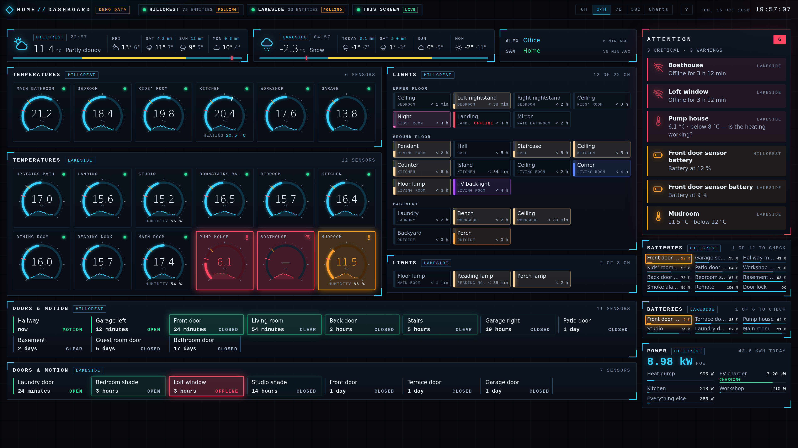
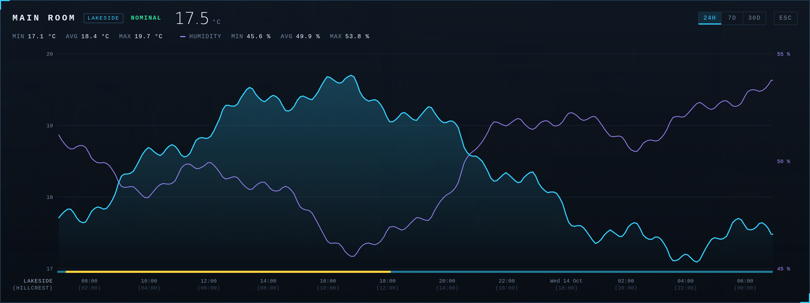
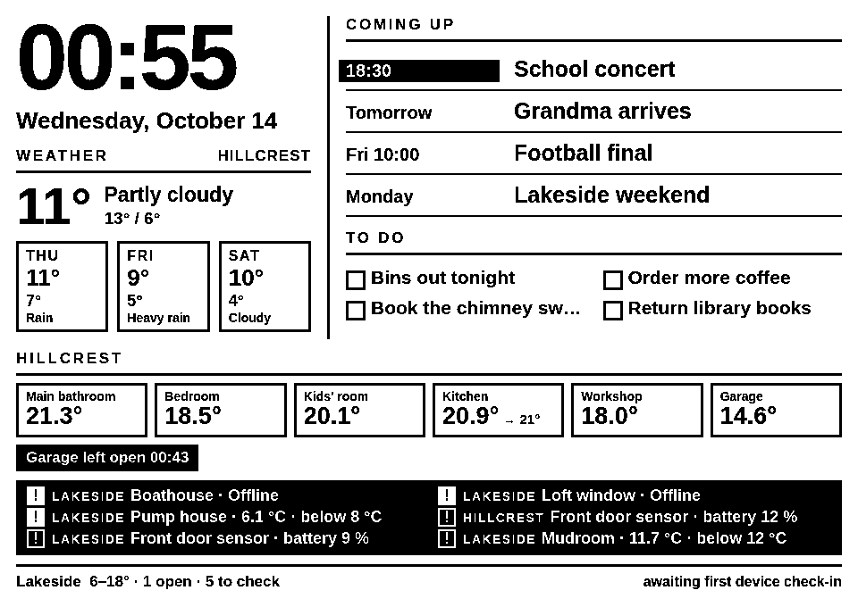

# homeframe

A live dashboard for one or more homes, built on Home Assistant. One small
Python server keeps every house's state in memory, decides what needs a look,
and shows it on a wall screen in the browser — and, as a second outlet, on a
13.3" e-paper frame.



<sub>Two houses from the built-in demo (`--demo`): made-up names, the scale of a real setup.</sub>

```
homeframe/
├── server/     The core: Home Assistant client, web dashboard, frame renderer (Python)
├── firmware/   ESP32 firmware for the e-paper frame (PlatformIO + Arduino + GxEPD2)
├── hardware/   Enclosure and mount models for the frame
└── docs/       Frame hardware notes, wiring, datasheets
```

## The dashboard

One dark, dense screen, designed for 1920×1080 (a 4K screen gets the same
layout magnified; phones get it stacked):

- **Weather** for each house, with a strip across the day showing sunrise,
  sunset and where now is, in the house's own time.
- **People** — where each person is: home, a known place, a street, or how far
  from home.
- **Temperatures** as gauges with sparklines; click one for its history, with
  humidity, daylight, and the house's local time.
- **Lights** by floor and room, in each light's own colour, with a bar for the
  brightness.
- **Doors, motion and shades** — most recent first, blinking while active and
  fading from green over the day after.
- **Power** — what the house draws now and today, circuit by circuit, from
  an energy monitor in the electrical panel.
- **Attention** — everything that needs a look across all houses: cold rooms,
  offline devices, low batteries, an unreachable Home Assistant.
- **Batteries** of every device, emptiest first.

Updates are pushed: the server keeps a WebSocket open to each Home Assistant
and passes changes to the browser over server-sent events, so a door opening
shows within a second. Polling stays on as a fallback, and the top bar shows
which houses are live.

Click a gauge for its history: temperature and humidity, when the sun was up,
and for a house elsewhere both its own time and the time at home.



## How it works

```
 Home Assistant × N ──WebSocket + REST──┐
                                        ▼
 ┌──────────────── server (any always-on box) ────────────────┐
 │  core: state per house, attention rules, weather, people,  │
 │  lights, calendar, to-dos, history                         │
 │    ├─ /             web dashboard, live in a browser       │
 │    └─ /frame.bin    the same data as a packed 1-bit image  │
 └───────────────────────────────┬────────────────────────────┘
                                 │ HTTP, 81600 bytes (or 304)
                                 ▼
                    ESP32 + 13.3" e-paper frame
```

Tokens stay in the server. Browsers and the frame only ever talk to it, never
to Home Assistant directly. Which houses, sensors, places and people appear is
all configuration (`server/config.yaml`, git-ignored), not code.

## Quick start

```bash
cd server
python3 -m venv .venv && .venv/bin/pip install -r requirements.txt
.venv/bin/python -m homeframe --demo     # synthetic data, no Home Assistant needed
open http://localhost:8080/              # the dashboard
open http://localhost:8080/preview.png   # what the e-paper frame will show

cp config.example.yaml config.yaml       # your Home Assistant URLs + tokens
.venv/bin/python -m homeframe            # the real thing
```

A step-by-step guide for a new setup, config section by section, is in
[docs/setup.md](docs/setup.md). Routes, the attention rules and the server's
internals are in [server/README.md](server/README.md).

## The e-paper frame

An ESP32 behind an A4-sized e-ink panel shows the home house at a glance —
clock, weather, starred calendar events, to-dos, temperatures, open doors and
attention items — and updates quietly in place.



The server renders the frame as an HTML page in headless Chromium, turns it
into pure black and white, and packs it into the 81600 bytes the panel's
controller takes. Rendering HTML server-side means design changes are a
browser reload rather than a reflash. `/frame.bin` carries an `ETag`, so an
unchanged screen costs one `304` and the panel is left alone. Without the
server, the device draws its own clock and a diagnosis of what is wrong.

| Part | Detail |
| --- | --- |
| Panel | Good Display **GDEM133T91** — 13.3", 960×680, monochrome |
| Controller | **SSD1677**, 4-wire SPI, 24-pin 0.5 mm FPC, 3.3 V |
| Board | Good Display **ESP32-L(C02)** — ESP32-WROOM-32D, USB-C (CH340), DESPI-C02 adapter |
| Pins | BUSY 13 · RST 12 · DC 14 · CS 27 · SCK 18 · MOSI 23 (GxEPD2's documented pinout) |

Measured on the real panel: full refresh 2.97 s, fast partial refresh 0.48 s,
frame transfer over WiFi 2.7–10 s. A full refresh every
`HF_FULL_REFRESH_EVERY` updates clears ghosting; long-run behaviour over days
of partial refreshes still needs watching.

```bash
cd firmware
cp include/secrets.h.example include/secrets.h   # WiFi + the server's URL
pio run --target upload && pio device monitor
```

Bring-up notes are in [docs/bringup.md](docs/bringup.md), the enclosure in
[hardware/](hardware/README.md).

## Reference

- [GDEM133T91 product page](https://www.good-display.com/product/480.html) ·
  [ESP32-L driver board](https://www.good-display.com/product/338.html)
- [GxEPD2](https://github.com/ZinggJM/GxEPD2) — panel driver (`GxEPD2_1330_GDEM133T91`)
